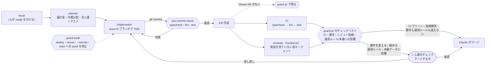
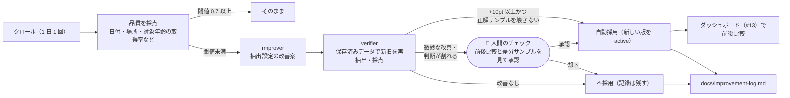

# kids-event-hub-open

子供向けイベント情報を自動収集し、都道府県 × 日付で探せるようにするサービス。
自治体・公共施設の PDF チラシを Claude が読んで構造化します。

> ハッカソン提出用リポジトリ（締切: 2026-11-08 20:00 JST）。ライセンス: [MIT](./LICENSE)

## 課題

（TODO）子供向けイベントの情報は自治体・公共施設ごとに散らばり、PDF チラシで公開されることも多く、横断して探しにくい。

## 解決

（TODO）PDF / HTML を Claude で構造化し、都道府県 × 日付で検索できるようにする。

## 公開 URL

https://kids-event-hub.hashiba-baan-daiki.workers.dev （`/healthz` で死活確認）

## 使い方

（TODO）検索サイト、MCP サーバーの使い方。

### 収集元の管理

収集元は [`sources.yaml`](./sources.yaml) で管理し、同期コマンドで D1 の `sources` テーブルに反映します（正は D1）。

```sh
pnpm sync-sources --dry-run   # 検証と計画の表示のみ
pnpm sync-sources             # ローカル D1 に反映
pnpm sync-sources --remote    # 本番 D1 に反映（オーナーのみ）
```

- ファイルの行は `submitted_by = owner` / `status = approved` で upsert。クローラーは approved・有効・policy が ng でない行だけを対象にします
- ファイルから消した行は削除せず無効化（`enabled = false`）。owner 以外の入口から入った行は触りません
- Claude Code では `/add-source <URL>` で robots.txt・利用規約の確認 → 追記 → 同期まで行います

### 収集方針とクローラー

クローラー（`apps/crawler`）は Cron Trigger で 1 日 1 回（03:00 JST）、クロール対象の収集元を順に取得します。

**収集元ごとの利用条件の確認**（登録前。`pnpm check-policy <URL>` が提案し、オーナーが確定して `sources.yaml` の `policy` に書く）

| 判定 | 基準 | 扱い |
| --- | --- | --- |
| `ng` | robots.txt で該当パスが `Disallow`、または利用規約で自動取得・クローラーを明確に禁止 | クロールしない |
| `caution` | 「無断転載禁止」程度の一般的な注意書き、対象が不明確、規約ページが見つからない | 下記の配慮をした上で取得する。一覧で後から見直す |
| `ok` | 自動取得・転載についての制限の記述がない | 取得する |

公共・公益性の高い情報は、書き手が自動取得を想定せずに一般的な文言を置いていることが多いため、曖昧な記述は次の配慮をした上で進めます。

- 取得頻度は 1 日 1 回程度（前回から 20 時間たっていない収集元は取得しない）。同じホストへは robots.txt の `Crawl-delay`（なければ 1 秒、上限 60 秒）以上あける
- User-Agent に連絡先を明記: `kids-event-hub-crawler/0.1 (+https://github.com/hashibadaiki/kids-event-hub-open)`
- 本文は転載せず、Claude が書いた 100 文字以内の要約と元 URL へのリンクのみ載せる。JSON-LD / iCal / RSS の説明文も Claude で要約する（説明文そのものは保存しない）。API キーがない・要約に失敗したときは要約なしで保存する
- クロールのたびに robots.txt を確認し、禁止されたパスは取得しない。その収集元は `status = rejected` / `policy_status = ng` にし、`policy_note` に robots.txt の URL・該当した規則・対象 URL・検出日時を残す（`crawl_runs` にも failed として記録）。sources.yaml で `policy.status: ng` にした収集元も rejected で登録する。rejected は同期しても approved に戻らないので、解除するときは D1 の行を直接直す
- 1 回の取得はサイズ上限 10MB・タイムアウト 20 秒

**削除依頼・お問い合わせ**: [GitHub の issue](https://github.com/hashibadaiki/kids-event-hub-open/issues) でご連絡ください。掲載の停止依頼は速やかに対応し、該当の収集元を無効化します。

**抽出手段の優先順位**: JSON-LD（schema.org/Event）→ iCal → RSS → HTML（Claude で構造化）→ PDF（Claude で構造化）→ LLM フォールバック（JSON-LD などのつもりで登録したページに見つからなかったとき）。
種別は Content-Type・URL・本文から判定します。抽出したイベントは `packages/core` で日付・年齢・料金・カテゴリを正規化し、重複判定してから `events` に保存します。実行結果（件数・日付が取れた数・保存数・エラー）は `crawl_runs` に記録します。

```sh
pnpm check-policy https://example.jp/events/   # robots.txt・規約を確認して policy を提案（書き込まない）
pnpm try-extract https://example.jp/dayori.pdf  # 取得・抽出して結果と日付取得率を表示（書き込まない。ANTHROPIC_API_KEY が必要）
pnpm try-extract https://example.jp/kodomo/ pdf # 一覧ページから PDF をたどる場合
cd apps/crawler && pnpm dev                     # ローカル D1 で起動（--test-scheduled）
curl "http://localhost:8787/__scheduled?cron=0+18+*+*+*"   # Cron を手動で起動
```

**PDF チラシ**: PDF は Claude API にそのまま（document として）渡し、イベントの配列（タイトル・開催日・時間・会場・対象年齢・料金・申込方法・要約）を受け取ります。1 枚に複数のイベントが載った広報や、月間カレンダー形式にも対応し、開催日が複数あるイベントは日付ごとに分けて保存します。掲載元（`source_url`）は PDF の URL です。収集元を `type: pdf` で登録した URL が HTML の一覧ページなら、同じホストの PDF リンクをたどり、それぞれ robots.txt も確認します。一度抽出した PDF は `pdf_documents` に記録し、次回以降は取得・抽出しません（過去の月の PDF が残り続ける一覧で、毎回 Claude に読ませないため）。新しい PDF は 1 回のクロールで 5 件まで処理し、残りは次回に回します（robots.txt で禁止の PDF はこの枠を使いません）。取得・抽出に失敗した PDF は、まだ試していない PDF の後に取り直し、3 回失敗したらあきらめます。PDF 直リンクで登録した収集元は、同じ URL で中身が差し替わるので毎回読み直します。

HTML・PDF の抽出には Claude API を使います。本番では `ANTHROPIC_API_KEY` を Worker の secret に設定します（オーナー作業）。ローカルでは `apps/crawler/.dev.vars` に書きます（コミットしない）。

### 運用ダッシュボード

クロール結果・抽出品質・自動改善の前後比較は Claude の Dashboard で見ます（管理画面は自作しません）。
データは読み取り専用の `GET /api/dashboard`（JSON、認証なし、公開してよい集計のみ）。構成とデモで映す場面は [docs/dashboard.md](./docs/dashboard.md)。

### 検索サイト

ログイン不要・モバイル向けの SSR ページ。URL は固定で、そのまま共有できます。

| URL | 内容 |
| --- | --- |
| `/` | 都道府県一覧（イベントがある県だけ） |
| `/kagawa/2026-11-08` | 香川県で 2026-11-08 に開催中のイベント |
| `/kagawa?from=2026-11-01&to=2026-11-30` | 期間で絞り込み（未指定は今日から 30 日間、最大 92 日） |
| `?age=5` | 対象年齢で絞り込み（0〜18。年齢の記載がないイベントは残す） |
| `/events/123` | イベント詳細（掲載元ページ / PDF チラシへのリンク） |

### MCP サーバー（Claude から検索する）

検索サイトと同じデータを、MCP（Model Context Protocol）のツールとして提供します。**検索のみ**で、書き込み系のツールはありません。認証は不要です。

- エンドポイント: `https://kids-event-hub.hashiba-baan-daiki.workers.dev/mcp`（Streamable HTTP。ステートレスで、POST に JSON で応答します）
- ツール:

| ツール | 引数 | 返すもの |
| --- | --- | --- |
| `search_events` | `prefecture`（必須。「香川県」「香川」「kagawa」）、`from` / `to`（JST の `YYYY-MM-DD`。省略時は今日から 30 日間、最大 92 日）、`age`（0〜18）、`keyword`（タイトル・概要・会場・市町村の部分一致、空白区切りで AND）、`limit`（1〜50、既定 20） | 期間中に開催中のイベント（開始日時順）。日時・会場・対象年齢・料金・詳細ページ URL・掲載元 URL。今日の日付 `today` も返す |
| `get_event` | `id`（`search_events` の結果の id） | イベントの全項目 |

**Claude Code** から:

```sh
claude mcp add --transport http kids-event-hub https://kids-event-hub.hashiba-baan-daiki.workers.dev/mcp
```

**Claude Desktop / claude.ai** から: 設定 → コネクタ → 「カスタムコネクタを追加」で、上の URL を入力します。
コネクタを追加できない環境では、`claude_desktop_config.json` に [mcp-remote](https://www.npmjs.com/package/mcp-remote) 経由で登録します（Node.js が必要）。

```json
{
  "mcpServers": {
    "kids-event-hub": {
      "command": "npx",
      "args": ["-y", "mcp-remote", "https://kids-event-hub.hashiba-baan-daiki.workers.dev/mcp"]
    }
  }
}
```

あとは Claude に「今週末の香川の子供向けイベント教えて」と聞くと、`search_events` で探して答えます。デモの流れは [`docs/mcp-demo.md`](./docs/mcp-demo.md)。
ローカルで試すときは `wrangler dev` を起動し、URL を `http://localhost:8787/mcp` にします。

### 開発

```sh
corepack enable          # pnpm 11
pnpm install
pnpm typecheck && pnpm lint && pnpm test
cd apps/web && pnpm exec wrangler dev   # ローカル D1 で起動
```

デプロイ（オーナーのみ）:

```sh
cd apps/web
pnpm exec wrangler d1 migrations apply kids-event-hub --remote
pnpm exec wrangler deploy
cd ../crawler
pnpm exec wrangler secret put ANTHROPIC_API_KEY   # 初回のみ
pnpm exec wrangler deploy                          # クローラー（Cron Trigger）
```

## アーキテクチャ

（TODO）Cloudflare Workers + D1、Hono、Drizzle、TypeScript。クローラー、正規化、Web / MCP の構成図。

## Claude 活用

（TODO）PDF / HTML の構造化、抽出設定の自動改善、MCP サーバー、開発での Claude Code 活用。

### Claude Code をソフトウェアファクトリーとして回す

開発と運用の両方を、Claude Code を中心にした 2 つのループで回しています。**Claude が計画・実装・検証を進め、人間は要所でチェックして採否を決めます**（全自動にはしません）。部品は `.claude/` にそのまま残しています（詳細: [`.claude/README.md`](./.claude/README.md)、開発ルール: [`CLAUDE.md`](./CLAUDE.md)）。

#### どの目的にどの仕組みを使ったか

| 目的 | 仕組み | 実体 |
| --- | --- | --- |
| 繰り返す作業を毎回同じ手順で行う | **Skills** | `/add-source`（収集元の追加）、`/crawl`（1 件クロール）、`/improve`（抽出設定の改善）、`/review-pr`（レビューのまとめ） |
| 役割ごとに文脈と権限を分ける（作った本人と別の目でレビュー・検証） | **サブエージェント** | 開発: `planner` → `implementer` → `reviewer`。運用: `improver` → `verifier`。レビュー役・検証役は書き込みツールなし |
| ルールを「お願い」ではなく機械的に守らせる | **フック** | `guard-bash`（デプロイ・ログイン・secret・リソース作成・`--remote`・main への push を止める）、`pre-commit-check`（コミット前に typecheck・lint・test）、`migration-notice`（スキーマ変更時の注意）、`guard-pr`（PR の issue 紐付けを確認・マージ前にチェックリストを渡し、要件・運用ルール・本番に触れる PR はオーナーに回す） |
| 作ったサービスを Claude 自身からも使う | **MCP** | `.mcp.json` に検索 MCP サーバー（`search_events` / `get_event`）を登録。Claude Code から実データを引いてクロール結果を確かめられる |
| データを Claude で構造化・改善する | **Claude API** | PDF / HTML の構造化、要約、抽出設定の改善案（クローラー内） |

#### ループ 1: 開発ループ（issue → 実装 → レビュー → マージ。要件・運用ルール・本番に触れる PR は人間が承認）



#### ループ 2: 運用ループ（クロール品質の自動改善）



#### 人間のチェックポイント（何を見て判断するか）

| チェックポイント | 誰が・どこで | 何を見て判断するか |
| --- | --- | --- |
| **着手**（issue に `ready`） | オーナー / GitHub | 要件（ゴール）と「やること」が明確か。依存する issue が片付いているか |
| **PR のマージ**（要件を変える・緩める、運用ルール・本番データに影響する PR だけ。それ以外は CI グリーンなら Claude がマージ） | オーナー / GitHub（Claude Code ではマージ操作の前に `guard-pr` がチェックリストを渡し、該当する PR は Claude がマージせず止まる） | ① CI がグリーン ② issue の「やること」が全部満たされ、要件を緩めていない（PR 本文の「未対応」「判断に迷った点」） ③ `/review-pr` の指摘が解消済み ④ 本番データ・運用ルールへの影響（migration、`CLAUDE.md`・`.claude/` の変更）と「オーナー作業」の内容 |
| **改善案の承認**（`/improve` の判定が human） | オーナー / Claude Code の会話 | ① 前後のスコアと指標（日付・場所・対象年齢の取得率、重複率、欠損率、件数） ② 正解サンプルを落としていないか ③ 差分サンプル（新しく取れた / 取れなくなったイベント）が実際のページと合っているか ④ 過去に却下した案（`docs/improvement-log.md`）の繰り返しでないか |
| **デプロイ** | オーナー / 手元のターミナル（`wrangler deploy`、`--remote` の migration、`secret put`。Claude は `guard-bash` で実行できない） | ① マージ済みの PR の「オーナー作業」 ② migration を Worker より先に適用する順番 ③ デプロイ後の `/healthz` と検索結果・ダッシュボードの確認 |

デモの台本: [`docs/factory-demo.md`](./docs/factory-demo.md)。採用しなかった改善案や失敗したクロールの記録: [`docs/improvement-log.md`](./docs/improvement-log.md)。

## 秘密情報の扱い

API キー・トークン・個人情報を、コード・コミット・issue・PR・チャットに書かないこと。
本番の秘密情報は `wrangler secret put <NAME>` で Cloudflare に設定します。
ローカル開発用の値は `.dev.vars`（`.gitignore` 済み）に置き、コミットしません。
